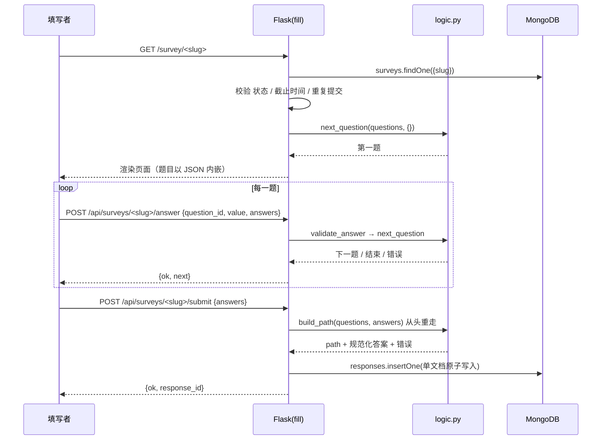

# 系统设计

## 1. 目标与范围

第一阶段要交付一个"够用但不简陋"的在线问卷系统：账号、建卷、出链接、跳转作答、统计。
界面按课程要求保持简单，重点放在三件事上：数据怎么存、跳转怎么算、错误怎么挡。

不做的事情也明确写下来，避免后续误判为遗漏：不做邮件通知、不做题目拖拽排序（用上移/下移）、不做导出 Excel、不做前端框架工程化。

## 2. 角色与权限

系统只有两种身份，但两种身份都必须在服务端校验：

| 角色 | 能做什么 | 边界 |
| --- | --- | --- |
| 登录用户（问卷创建者） | 创建/编辑/发布/关闭/删除自己的问卷，查看自己问卷的统计 | 只能看到 `owner_id` 等于自己的问卷，越权一律 404 |
| 登录用户（填写者） | 打开别人发来的链接并提交 | 必须登录；匿名问卷不记录身份，但仍需登录 |

"填写者需要登录"与"允许匿名"并不矛盾：登录是访问门槛，匿名是**不把身份写进回答记录**。
因此匿名问卷的 `respondent_id` 恒为 `null`，代价是无法按人限制重复提交——这一点在数据库设计文档里作为权衡明确写出。

## 3. 模块划分

```
浏览器
  │  HTML 表单 / JSON
  ▼
Flask 蓝图
  ├─ auth     注册、登录、退出（会话 Cookie，签名由 SECRET_KEY 保证）
  ├─ surveys  问卷 CRUD、题目 CRUD、发布/关闭、跳转规则配置
  ├─ fill     填写页 + /api/answer + /api/submit
  ├─ stats    聚合管道统计（整卷 / 单题）
  └─ export   统计结果导出 Excel（复用 stats 的口径，只负责排版）
  │
  ├─ logic.py  纯函数：validate_answer / resolve_target / build_path / next_question
  └─ db.py     MongoDB 连接、$jsonSchema 校验器、索引
        │
        ▼
     MongoDB（users / surveys / questions / responses）
```

分层的原则是：**跳转与校验只写一遍**。`logic.py` 不 import Flask，也不 import pymongo，
所以它能被 pytest 直接调用；页面、API、测试三处共用同一套规则，不会出现"前端跳过去了、后端不认"的偏差。

## 4. 典型流程

### 4.1 建卷与发布

1. `POST /surveys/new` 写入 `surveys`，状态 `draft`，生成唯一 `slug`。
2. 逐题 `POST /surveys/<id>/questions`，写入 `questions`，`order` 递增，同时 `$inc` 问卷的 `question_count`。
3. 题目跳转在 `POST /surveys/<id>/questions/<qid>` 里配置，写进该题的 `logic.jumps`。
4. `POST /surveys/<id>/publish`：校验至少一题，状态改为 `published` 并记录 `published_at`。

### 4.2 填写



关键点：**提交时不是"信任客户端给的答案列表"，而是从头再走一遍**。
这样即使有人直接构造请求，也无法给被跳过的题目塞答案，或绕过必答。

### 4.3 统计

统计完全走数据库聚合：`$match → $unwind → $group`，Python 只负责补零（没人选的选项要显示 0）和排序。
回答量再大也不会把整批文档拉到内存里。

导出 Excel 时同样调用 `question_stats`，不另写一套统计口径——避免"页面上是 66.7%、导出的表是 65%"这类不一致。
导出模块只做工作簿排版与下载响应，计算仍然复用统计层。

## 5. 状态机

问卷只有三个状态，转换关系刻意做得很窄：

```
draft ──publish──▶ published ──close──▶ closed
  ▲                    │                 │
  └──────编辑题目───────┘                 └── 可重新 publish 回到 published
```

- `draft`：可编辑，链接不可填写（403）。
- `published`：可填写；仍允许改题（第一阶段允许多次修改，第二阶段会讨论这对已有回答的影响）。
- `closed`：不接受新回答，已有回答与统计保留；可重新发布。

截止时间不是状态，而是 `published` 上的一条时间约束：`deadline <= now()` 时填写一律拒绝，统计仍可看。

## 6. 并发、一致性与失败处理

- 提交回答是**单文档插入**，天然原子；不会出现"答案写了一半"的中间态。
- 同一用户重复提交：非匿名问卷在提交时按 `(survey_id, respondent_id)` 查一次；数据库层没有加唯一索引，
  因为需求允许"同一人多次填写"，是否限制是问卷级开关，用索引强约束反而会把合法场景堵死。
- `question_count` 是冗余计数，用 `$inc` 维护；它只用于列表展示，真实题数始终以 `questions` 集合为准，
  所以即使计数漂移也不会影响业务正确性。
- 删除题目时会顺手清理其他题目里指向它的跳转，避免留下悬空目标；`logic.py` 仍然对悬空目标做防御。

## 7. 安全相关

- 密码不明文存储，使用 `generate_password_hash`（默认 scrypt，测试里校验了前缀）。
- 会话使用 Flask 签名 Cookie，`HttpOnly` + `SameSite=Lax`。
- 所有"我的问卷"入口统一走 `owned_survey_or_404`，越权返回 404 而不是 403，避免泄露问卷是否存在。
- 模板默认转义，填写页内嵌的 JSON 用 `tojson` 输出，不会被当成 HTML 执行。

## 8. 为第二阶段留的余地

- `responses` 里有 `survey_version` 字段，将来区分不同版本问卷的回答。
- 跳转规则是数据（`logic.jumps`），不是代码分支，加新条件类型只需扩展 `match_condition`。
- `questions.rules` 是自由对象，加新校验项不需要改集合结构（校验器只约束类型，不锁死字段）。
- 删除题目时的跳转清理、统计按 `answers.question_id` 分组，都假设题目可以被增删——第二阶段改题型时不用推翻。
